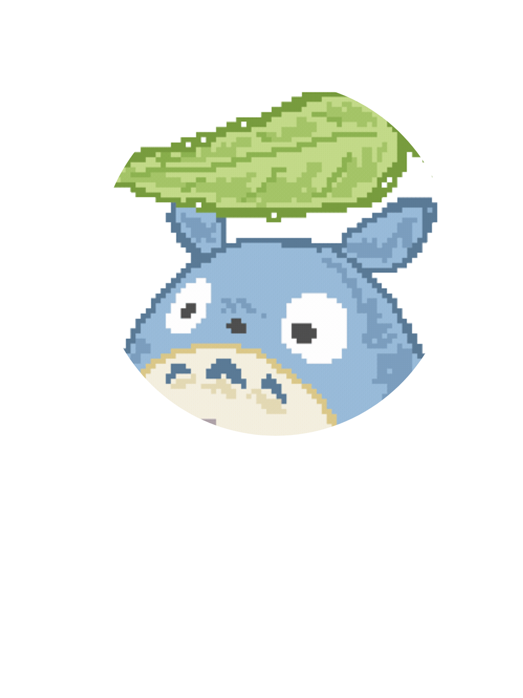
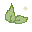

<!-- ==================== INÍCIO ==================== -->

  

  <h1>Hello, World!</h1>

  
Seja bem-vindo ao meu perfil!

 

<!-- ==================== CONTACT ==================== -->

  <h2>
    
    CONTACT
  </h2>

  

    
    &nbsp;&nbsp;
    
  

 

<!-- ==================== ABOUT ME ==================== -->

<h2 align="center">
  
  ABOUT ME
</h2>

  

    Olá! Me chamo Jade, tenho 24 anos e estou cursando Engenharia da Computação na Univiçosa.
     
    Tenho interesse em desenvolvimento web, análise de dados e tecnologia aplicada a impacto social.
     
    Gosto de projetos que unem criatividade, organização e propósito.
  

 

<!-- ==================== LANGUAGES | TOOLS ==================== -->

 <h2> LANGUAGES | TOOLS</h2>

<table align="center">
<tr>
<th align="center">LANGUAGES</th>
<th align="center">TOOLS</th>
</tr>
<tr>
<td align="center">

</td>
<td align="center">

</td>
</tr>
</table>

 

<!-- ==================== PROJECTS ==================== -->

<h2 align="center">
  
  PROJECTS
</h2>

  <h3>SouJunior</h3>

  <strong>Apoie essa Causa — Landing Page</strong>

  

    Desenvolvimento colaborativo de uma landing page responsiva,
    com foco em acessibilidade, interatividade e experiência do usuário.
  

  
  
  

    

  

 

<!-- ==================== GITHUB CONTRIBUTIONS ==================== -->

<h2 align="center">
  
  GITHUB CONTRIBUTIONS
</h2>

  

